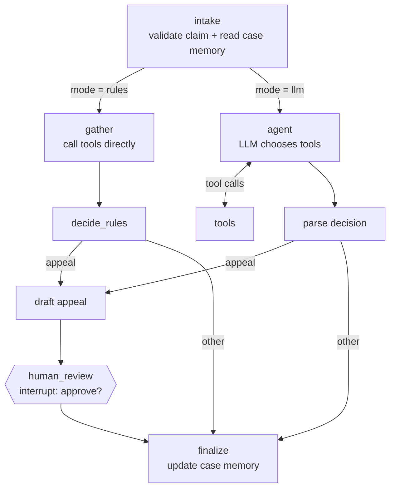

# Claim Denial Triage Agent

An agentic workflow, built with **LangGraph**, that triages denied US healthcare claims. For each denial it decides whether to **correct and resubmit**, **appeal**, **write off**, or **escalate to a human**, and drafts an appeal behind a **human approval step**.

The project focuses on **evaluation**: it measures decision accuracy, tool use and failure modes on a labelled dataset, rather than showing a single happy-path demo.

> **Status: work in progress (started Oct 2026).** The workflow, tools, memory, human-in-the-loop step and evaluation harness are working. The rules baseline is evaluated. An LLM-agent evaluation run and appeal-quality scoring are next (see [Roadmap](#roadmap)).
>
> All data is **synthetic**. No real patient, provider or payer data is used.

---

## Why this problem

Denied claims are a major source of lost revenue for US healthcare providers. Each denial carries a **CARC** (Claim Adjustment Reason Code), but the right next step depends on the claim's facts: is information missing? Was prior authorization obtained? Is there documentation of medical necessity? Analysts check these by hand. This repo explores how an agent can do the checking and the routing, while a human stays in control of anything sent to a payer.

## Architecture



| Component | What it does |
|---|---|
| **Tools** (`src/tools.py`) | `lookup_denial_code`, `check_claim_fields`, `search_payer_policy` (retrieval over policy excerpts), `draft_appeal` |
| **Two modes** (`src/graph.py`) | `rules`: deterministic baseline that runs offline. `llm`: a tool-calling LLM decides which tools to call and makes the decision |
| **Human-in-the-loop** | LangGraph `interrupt()` pauses before any appeal is finalized; the run resumes with the reviewer's answer via `Command(resume=...)` |
| **Short-term memory** | LangGraph checkpointer (`InMemorySaver`) keeps each claim's state, which is what makes pause-and-resume possible |
| **Long-term memory** (`src/memory.py`) | Case memory across claims: how often each (payer, denial code) pair ended in each action, passed to the agent as context |
| **Evaluation** (`eval/evaluate.py`) | Accuracy with 95% bootstrap CI, per-code accuracy, confusion matrix, tool-call recall, escalation rate, error list |

## Dataset

`data/generate_claims.py` builds **36 synthetic denied claims** (seeded, reproducible) using real CPT, ICD-10 and CARC code formats:

| Denial code | Meaning | Correct action depends on |
|---|---|---|
| CO-16 | Claim lacks information | Fix missing fields, resubmit |
| CO-4 | Modifier missing / inconsistent | Add modifier, resubmit |
| CO-18 | Exact duplicate | Write off (already adjudicated) |
| CO-29 | Timely filing limit expired | Appeal only with proof of timely filing |
| CO-50 | Not medically necessary | Appeal only with clinical documentation |
| CO-197 | Prior authorization absent | Appeal only if authorization exists |
| CO-97 | Bundled into another service | Appeal only if a distinct service is documented |

The set includes **6 deliberately hard cases**: an unsupported code (CO-11), and claims where the deciding fact is **unknown** (missing from the record). The correct action for these is **escalate**, not a guess.

## Results so far

Rules baseline (`python eval/evaluate.py`), 36 claims:

| Metric | Value |
|---|---|
| Decision accuracy | **88.9%** (95% bootstrap CI 77.8% - 97.2%) |
| Accuracy on the 30 standard claims | 100% |
| Accuracy on the 6 hard cases | 33% (2 / 6) |
| Tool-call recall | 100% |

**Key finding:** the baseline treats *unknown* as *no*. When the authorization or documentation status is missing from the record, it writes the claim off instead of escalating. In practice this is the costly failure: claims that might have been paid are silently dropped. That is the behaviour the LLM agent and future versions must be evaluated against. Full report: [`results/eval_rules.md`](results/eval_rules.md).

## Run it

```bash
pip install -r requirements.txt

# Regenerate the synthetic dataset (optional; claims.json is included)
python data/generate_claims.py

# Evaluate the rules baseline (offline, no API key)
python eval/evaluate.py

# Triage one claim interactively, with the human approval step
cd src && python run.py --claim CLM-1004

# LLM agent mode (needs an API key, e.g. OPENAI_API_KEY)
export TRIAGE_MODEL="openai:gpt-4o-mini"   # any provider supported by init_chat_model
python src/run.py --claim CLM-1004 --mode llm
python eval/evaluate.py --mode llm
```

## Roadmap

- [x] LangGraph workflow with tools, short- and long-term memory, and human approval
- [x] Synthetic labelled dataset, including hard "unknown fact" cases
- [x] Evaluation harness and rules baseline
- [ ] Evaluate the LLM agent and compare it with the baseline, focusing on the hard cases
- [ ] Appeal-letter quality: a scoring rubric (correctness, groundedness in policy, completeness) plus LLM-as-judge, checked against human scores
- [ ] Larger and noisier dataset (conflicting fields, multiple denial codes per claim)
- [ ] FastAPI endpoint + Docker

## Project structure

```
data/      generate_claims.py, claims.json, payer_policies.md (synthetic)
src/       tools.py, graph.py, memory.py, run.py
eval/      evaluate.py
results/   evaluation reports and predictions
```

## Author

**Dr. Baby Komal**, PhD (Optics & Photonics, IIT Delhi). Two years evaluating production LLMs; interested in applied ML and rigorous evaluation for healthcare AI.
[LinkedIn](https://linkedin.com/in/dr-baby-komal-ph-d-02b809b0) · [GitHub](https://github.com/bkomal-gif)
